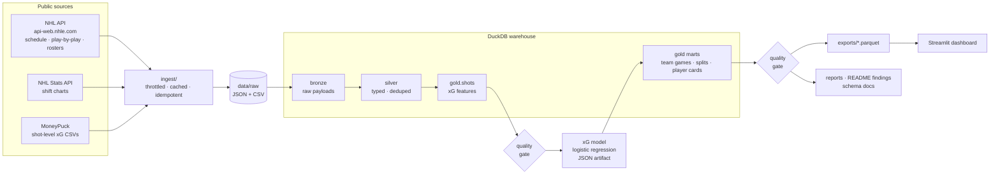
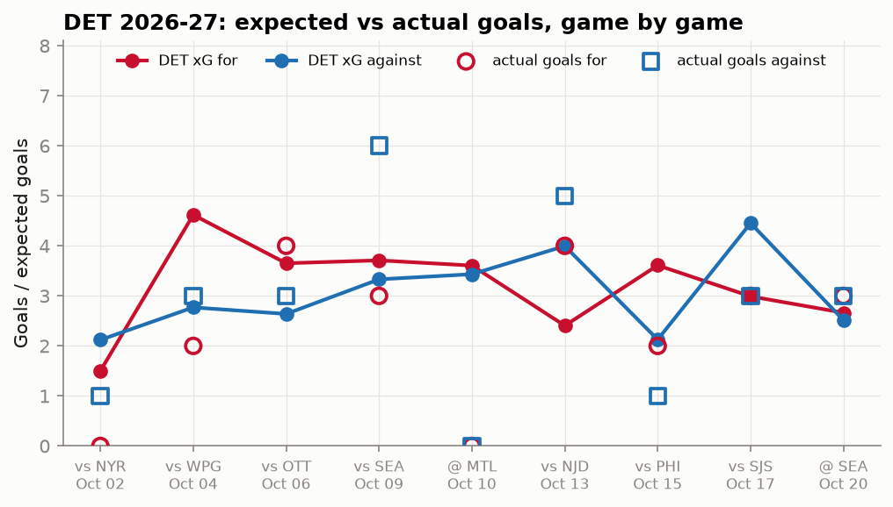
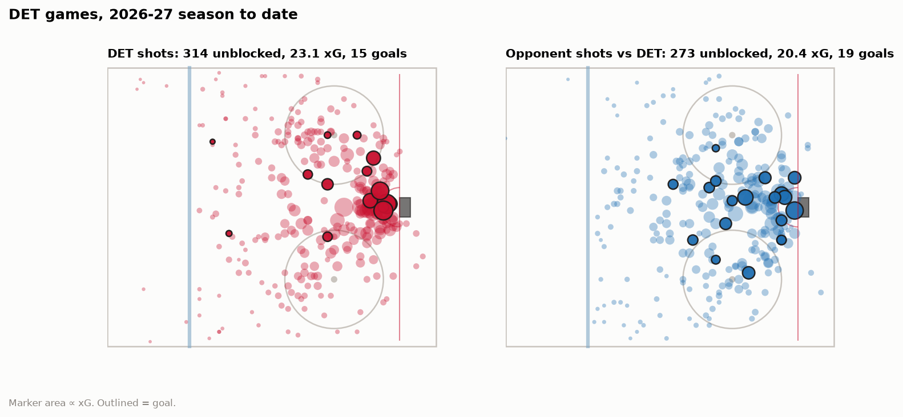
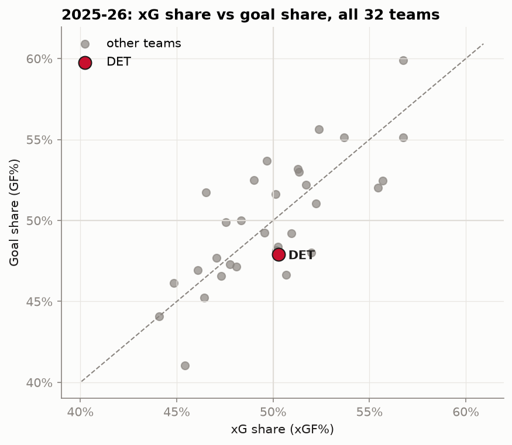
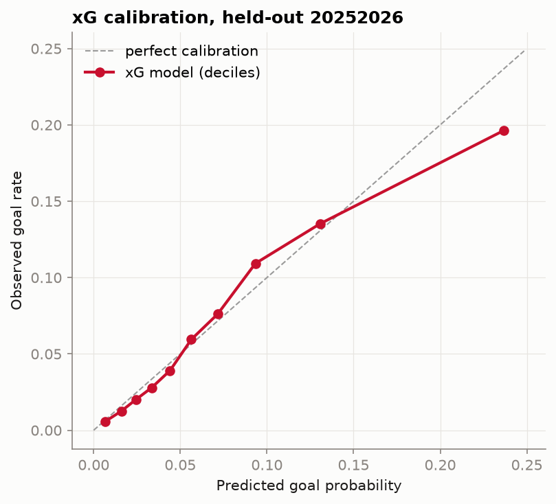
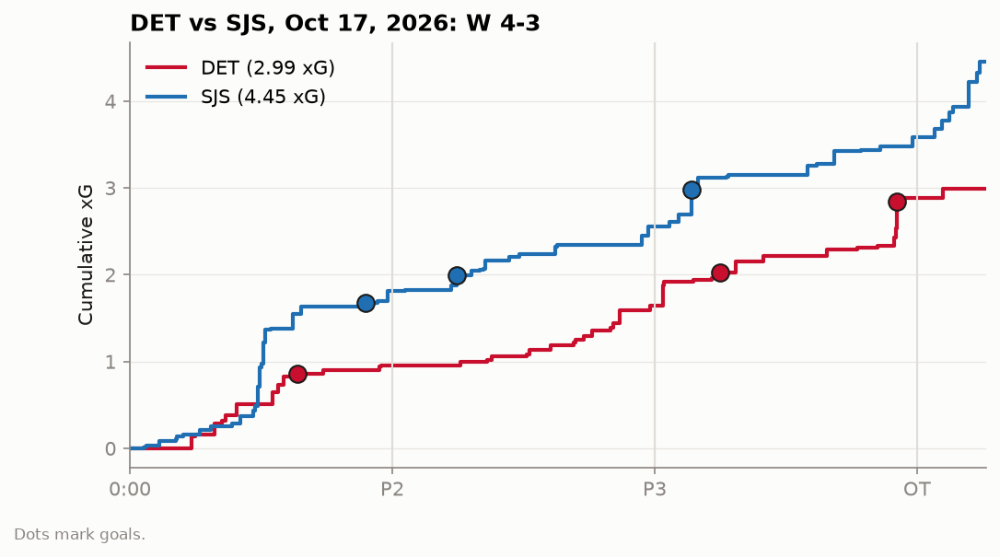

# Winged Wheel Analytics

**Live dashboard: [winged-wheel-analytics.streamlit.app](https://winged-wheel-analytics.streamlit.app/)**,
refreshed every morning from the pipeline in this repo ([refresh cadence](#data-refresh)).

[](https://github.com/adamddh/winged-wheel-analytics/actions/workflows/ci.yml)
[](https://github.com/adamddh/winged-wheel-analytics/actions/workflows/refresh.yml)

A hockey-operations data pipeline for the Detroit Red Wings. It ingests the official NHL API
and MoneyPuck's public data into a DuckDB warehouse (bronze → silver → gold), gates every run on
data-quality checks, fits an expected-goals model, and produces Red Wings analysis that
regenerates from scratch with one command.

Built as a working answer to the Red Wings' **Data Engineer, Hockey Operations** posting. The
[mapping below](#what-this-demonstrates) ties each part of the repo to a line in that posting.

```bash
git clone https://github.com/adamddh/winged-wheel-analytics && cd winged-wheel-analytics
make pipeline   # ingest -> warehouse -> quality gates -> xG model -> marts -> reports
make test       # unit + end-to-end tests
```

## Architecture



| Stage | Code | What it does |
|---|---|---|
| Ingest | `src/wings/ingest/` | `httpx` client with request pacing and backoff on 429/5xx. Immutable data (past seasons; games marked official, `gameState == OFF`) is fetched once. Writes are atomic. A re-run makes no calls for data it already has. |
| Bronze | `sql/bronze/` | One row per cached file, payload untouched: the replayable source of truth. |
| Silver | `sql/silver/` | Typed, flattened, deduplicated (`QUALIFY row_number()`): games, teams, plays, rosters, players, shifts, MoneyPuck shots. |
| Gold | `sql/gold_features/`, `sql/gold_marts/` | Shot features on rink-normalized coordinates; team-game facts; strength splits; player seasons with shift-based TOI and on-ice xG (interval join); MoneyPuck validation. |
| Quality | `src/wings/quality/` | 30+ SQL checks (row counts, completeness, freshness, null rates, duplicate keys, referential integrity, ranges). Any error-level failure stops the pipeline. Results go to `reports/quality.json`. |
| Model | `src/wings/models/xg.py` | Logistic-regression xG, season-split evaluation, MoneyPuck benchmark, generated [model card](models/MODEL_CARD.md). |
| Reports | `src/wings/analysis/` | Parquet exports for the dashboard, charts, the game recap, and the findings below. |

Schema docs are generated from the warehouse catalog: [docs/schema.md](docs/schema.md).
xG feature rationale: [docs/xg_model.md](docs/xg_model.md).

## Setup

Requires [uv](https://docs.astral.sh/uv/) (`curl -LsSf https://astral.sh/uv/install.sh | sh`).
uv installs Python 3.12 and the locked dependencies itself.

| Command | |
|---|---|
| `make pipeline` | Full run. The first run backfills two seasons of league-wide play-by-play (about 2,700 games, roughly 11 minutes at a polite 4 req/s). After that it's incremental, and a rebuild on cached data takes about 10 s. |
| `make test` | Unit tests (SQL macros, features, model, quality gate, ingest with mocked HTTP) plus an end-to-end run on a six-game fixture of real payloads. |
| `make lint` | `ruff check` + `ruff format --check` (also enforced in CI on every PR). |
| `make app` | Run the dashboard locally against `exports/` (http://localhost:8501). |
| `WINGS_OFFLINE=1 make pipeline` | Rebuild from cached `data/raw` without touching the network. |

Configuration lives in [`wings.toml`](wings.toml): seasons, focus team, focus players and
quality thresholds. It's validated with pydantic.

## Data refresh

[`refresh.yml`](.github/workflows/refresh.yml) runs `make pipeline` on GitHub Actions **every day
at 12:00 UTC** (7 a.m. Eastern in winter, 8 a.m. in summer). By then the night's games are
marked official in the NHL API. The raw cache persists between runs in the Actions cache, so a
daily run only fetches new games. If a quality gate fails, the job fails and nothing is
published. Otherwise the regenerated `exports/`, `reports/`, `models/` and README findings are
committed to `main`, and Streamlit Community Cloud redeploys the dashboard from that commit. The
dashboard header and the findings below both show the last refresh time.

## Dashboard

[`app/streamlit_app.py`](app/streamlit_app.py) reads only the gold exports (`exports/*.parquet`):

- **Season:** game-by-game xG vs. goals, splits by situation, and where Detroit sits in the league
- **Game by game:** cumulative xG timeline, shot map and best chances for any game
- **Players:** cards for Larkin, Raymond, Seider and Edvinsson (current and previous season)
  with their shot maps
- **Shot maps:** filter by season, shooter side, situation and player

The hero is a to-scale NHL rink drawn in SVG with every unblocked shot of the season on it.
`tests/test_app.py` renders the app headlessly against the committed exports in CI.

## Data sources

| Source | Used for | Notes |
|---|---|---|
| NHL API, `https://api-web.nhle.com/v1` | schedules (`/schedule/{date}`), play-by-play (`/gamecenter/{id}/play-by-play`), rosters (`/roster/{team}/{season}`) | Public and unauthenticated. Requests are paced and cached. |
| NHL Stats API, `https://api.nhle.com/stats/rest/en/shiftcharts` | shift charts for Red Wings games (TOI, on-ice stats) | The NHL doesn't publish shift charts for every game; coverage is disclosed in the findings. |
| [MoneyPuck](https://moneypuck.com/data.htm), shot data | independent validation of our xG | Shot data courtesy of MoneyPuck.com. Used only to benchmark, never as a model input. |

No scraping, no paywalled data. Raw responses are cached under `data/raw/` (git-ignored).

## Key findings

<!-- findings:start -->
_Generated by `make pipeline` from data through October 17, 2026
(last refresh 2026-10-20 16:28 UTC). Every number below is queried from the warehouse;
none are typed by hand. Interactive version: the
[live dashboard](https://winged-wheel-analytics.streamlit.app/)._

#### DET 2026-27 season to date

**8 GP, 3-3-2.**
DET has generated **26.1 xG** and allowed **24.9 xGA**
(51.2% xG share, rank 15 of 32). On those same shots they've
scored **18** goals against 26.1 expected (-8.1) and allowed
**22** against 24.9 expected (-2.9). At 5v5 the xG share is 54.1%.



| Situation | GP | xGF | GF | xGA | GA | xGF% |
|---|---|---|---|---|---|---|
| 5v5 | 8 | 17.3 | 13 | 14.7 | 12 | 54.1% |
| Power play | 8 | 6.8 | 4 | 1.1 | 0 | 85.7% |
| Shorthanded | 8 | 0.1 | 0 | 7.0 | 9 | 1.9% |
| Other (4v4, 3v3, EA) | 7 | 1.9 | 1 | 2.1 | 1 | 48.0% |
| All situations | 8 | 26.1 | 18 | 24.9 | 22 | 51.2% |



#### Player cards

| Player | Season | GP | G-A-P | TOI/GP | SOG | ixG | G − ixG | 5v5 on-ice xGF% |
|---|---|---|---|---|---|---|---|---|
| Dylan Larkin | 2026-27 | 6 | 1-2-3 | 21.8 | 14 | 1.72 | -0.72 | 55.8% |
| Dylan Larkin | 2025-26 | 74 | 34-33-67 | 20.2 | 225 | 33.68 | -3.68 | 47.9% |
| Lucas Raymond | 2026-27 | 8 | 0-4-4 | 20.5 | 23 | 2.80 | -2.80 | 53.3% |
| Lucas Raymond | 2025-26 | 80 | 25-51-76 | 18.8 | 172 | 19.65 | +4.35 | 49.4% |
| Moritz Seider | 2026-27 | 8 | 0-5-5 | 25.7 | 15 | 1.03 | -1.03 | 59.5% |
| Moritz Seider | 2025-26 | 82 | 10-50-60 | 25.7 | 187 | 9.83 | +0.17 | 55.2% |
| Simon Edvinsson | 2026-27 | 0 | – | – | – | – | – | – |
| Simon Edvinsson | 2025-26 | 72 | 9-16-25 | 22.4 | 86 | 5.63 | +1.37 | 52.1% |

_TOI and on-ice numbers come from official NHL shift charts, joined to every shot by game clock.
The NHL has published shift charts for 8 of DET's 8 games this season, so
TOI/GP and 5v5 on-ice xGF% use those games only. "–" means the player has not dressed._

#### League context and the xG model

For context, in 2025-26 DET posted a 50.3% xG share (rank 14 of 32), scored 34.7 fewer goals than its xG, and allowed 12.9 fewer than its xGA.



On the held-out 2025-26 season (111,099 unblocked shots), the model
scores **log loss 0.2226** vs. a 0.2490
constant-rate baseline, **ROC AUC 0.754**, and predicts
7,928 goals against 7,578 actual.
On 110,269 shots matched to MoneyPuck, shot-level correlation with their public xG is **0.59** (our log loss 0.2230 vs. MoneyPuck 0.2178).



### Game recap: DET vs SJS, Oct 17, 2026: W 4-3

DET lost the expected-goals battle 2.99-4.45 on 42-58 unblocked attempts and won the game 4-3 in a shootout.



| xG | P1 | P2 | P3 | OT | Total |
|---|---|---|---|---|---|
| DET | 0.96 | 0.68 | 1.24 | 0.10 | 2.99 |
| SJS | 1.82 | 0.74 | 1.03 | 0.87 | 4.45 |

**Top chances**

| Time | Team | Shooter | Type | Dist (ft) | Situation | xG | Result |
|---|---|---|---|---|---|---|---|
| P3 18:27 | DET | Alex DeBrincat | snap | 6 | other | 0.31 | GOAL |
| OT 3:54 | SJS | Alexander Wennberg | wrist | 7 | PP | 0.29 |  |
| P3 2:48 | SJS | Ivar Stenberg | wrist | 13 | PP | 0.29 | GOAL |
| P1 10:12 | SJS | Will Smith | snap | 18 | PP | 0.24 |  |
| P3 0:40 | DET | Andrew Copp | wrist | 7 | 5v5 | 0.24 |  |

<!-- findings:end -->

## What this demonstrates

| Posting asks for | Where it is in this repo |
|---|---|
| Large-scale relational databases | DuckDB warehouse with about 900k play-by-play events across 2.7k games: keyed silver entities, enforced uniqueness and referential integrity ([schema](docs/schema.md)) |
| Data modeling | Bronze/silver/gold layering; fact tables at explicit grains (shot, team-game, team-game-strength, player-season); conformed `players`/`teams` dimensions; documented surrogate keys |
| SQL | Every transform is SQL: window functions (`lag`, running score state), `QUALIFY` dedupe, an interval join of shots to shifts, reusable macros with unit tests ([sql/](src/wings/warehouse/sql)) |
| Data warehouses for analytics | Gold marts feed the dashboard, README findings and the model card; schema docs are generated from `COMMENT ON` metadata |
| Cloud (Azure/AWS) | CI and the scheduled data refresh run on GitHub Actions; the dashboard is hosted on Streamlit Community Cloud. An optional `export_uri = "s3://…"` mirrors gold tables to S3 through DuckDB httpfs (see [Cloud](#cloud)) |
| High-performance pipelines with data quality | Incremental, idempotent ingest; an 85x fix to the JSON flattening step (full rebuild about 10 s); a [quality gate](src/wings/quality/checks.py) that fails the run; [quality report](reports/quality.json) |
| AI tools to analyze, refine and refactor pipelines | [ai-log.md](ai-log.md): profiling-led performance fix, data-quality root causes, feature validation, refactor passes, and the AI's own mistakes and how they were caught |
| Python | Typed config (pydantic), `httpx` client, scikit-learn model exported to portable JSON, pytest suite, ruff-clean |
| Passion for hockey and current research | xG with research-backed features, rebound timing, score effects, on-ice 5v5 xGF% for defensemen, finishing and goaltending vs. expected, and an honest same-shot benchmark against MoneyPuck |

## Cloud

The pipeline is a single process over files, so it maps directly onto managed services:

| Here | AWS | Azure |
|---|---|---|
| `data/raw/` cache | S3 | ADLS Gen2 |
| `wings pipeline` on a schedule | ECS scheduled task / Lambda container | Container Apps job / Azure Functions |
| DuckDB file | DuckDB over S3 parquet, or Redshift / Athena | DuckDB over ADLS parquet, or Synapse / Fabric |
| `exports/` | S3 (`export_uri`, implemented) | ADLS (same `COPY` with DuckDB's `azure` extension) |

The S3 mirror is implemented but not exercised in CI (no cloud credentials in this public repo).

## Repository layout

```
src/wings/
  ingest/        NHL API + MoneyPuck clients (throttled, cached, idempotent)
  warehouse/     build.py runs sql/{bronze,silver,gold_features,gold_marts}; docs.py renders schema docs
  quality/       SQL data-quality gates
  models/        xG model (fit, JSON artifact, evaluation, model card)
  analysis/      exports, charts, findings, game recap
  cli.py         `wings pipeline` orchestration
app/             Streamlit dashboard (reads exports/)
tests/           unit + integration tests; fixtures/ holds real payloads for six games
models/          generated xG artifacts (model JSON, metrics, calibration, model card)
reports/         generated findings, figures, quality report
exports/         generated gold parquet for the dashboard
docs/            schema (generated) and xG model rationale
```

## License

[MIT](LICENSE). NHL data © NHL; MoneyPuck data courtesy of MoneyPuck.com.
